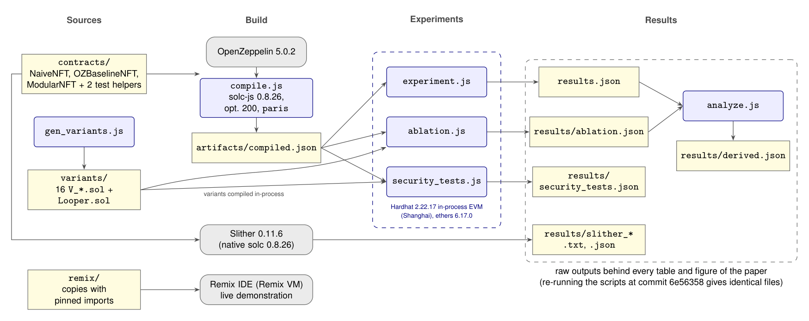

# ModularNFT: gas and security study of ERC-721 contracts

Code, test scripts and raw results for the project **"Enhancing the Efficiency and Security of NFT Smart Contracts: An Analytical Study of the NFTY Framework"** (DSE2170 Project Based Learning, Department of Data Science and Engineering, Manipal University Jaipur).

Authors: Abhinav Aryan, Piyush Priyadarshi, Shankhodeep Chanda, Shreya Aigal. Guide: Dr. Sanjeev Kumar Ojha.

This repository compares three ERC-721 contracts on a local Ethereum Virtual Machine (EVM):

| Contract | What it is |
|---|---|
| `NaiveNFT` | Hand-written baseline with **deliberate defects** (anyone can mint, anyone can burn, no supply cap, per-token URI on-chain). **Never deploy it.** |
| `OZBaselineNFT` | A typical OpenZeppelin build: `ERC721`, `ERC721URIStorage`, `ERC721Burnable`, `Ownable`. |
| `ModularNFT` | The proposed design: OpenZeppelin base plus an immutable supply cap, a shared base URI (no per-token URI storage), batch minting, pausable minting, a reentrancy guard and an authorization-checked burn. |

## Results (local Hardhat EVM, Solidity 0.8.26, optimizer 200 runs, OpenZeppelin 5.0.2)

Gas is the `gasUsed` value from each transaction receipt (includes the 21,000 gas base cost).

| Operation | NaiveNFT | OZBaselineNFT | ModularNFT |
|---|---:|---:|---:|
| Deployment | 723,735 | 1,276,590 | 1,366,715 |
| Mint, 1 token (mean of 20) | 165,156 | 171,661 | **82,012** |
| Mint 10 tokens (10 transactions) | 1,489,300 | 1,554,350 | 657,680 |
| Mint 10 tokens (1 batch transaction) | n/a | n/a | **326,468** |
| Transfer (mean of 10) | 39,421 | 39,655 | 39,744 |
| Burn by owner (mean of 10) | 45,414 | 29,322 | 29,340 |

Compared with `OZBaselineNFT`, `ModularNFT` uses 52.2% less gas per single mint and 79.0% less for ten tokens in one batch transaction. Transfer and burn are essentially unchanged and deployment costs 7.1% more.


Security behavior tests:

| Test | NaiveNFT | OZBaselineNFT | ModularNFT |
|---|---|---|---|
| Unauthorized mint | Succeeded | Blocked | Blocked |
| Burn another user's token | Succeeded | Blocked | Blocked |
| Supply cap (cap 5, 6 attempts) | None | None | Enforced |
| Mint while paused | n/a | n/a | Blocked |
| Reentrant mint from receiver callback | n/a | Accepted | Blocked |
| Slither high / medium findings | 0 / 0 | 0 / 0 | 0 / 0 |

Slither 0.11.6 did not flag the open mint and burn in `NaiveNFT` (access-control design flaws are not patterns its detectors recognize); the behavior tests did. Raw Slither output is in [`results/`](results/).

## Design: what is reused and what is new


Grey classes come from OpenZeppelin; green is code written for this study. More diagrams: [`docs/uml_mint_flow.png`](docs/uml_mint_flow.png) (flow of `mint()`) and [`docs/uml_reused_vs_new.png`](docs/uml_reused_vs_new.png) (the three contracts side by side). Graphviz sources (`.dot`) are included.

## Run it locally

Requires Node.js 18 or newer (tested on Node 22 and Node 24). Run these commands from the repository root:

```bash
npm ci
npm run compile
npm run experiment
npm test
```

- `npm ci` installs the exact dependency versions from `package-lock.json`.
- `npm run compile` compiles the Solidity contracts in `contracts/` with Solc 0.8.26 (optimizer 200 runs, `evmVersion: 'paris'`) and outputs `artifacts/compiled.json`.
- `npm run experiment` runs the primary three-contract comparison and updates `results.json`.
- `npm test` (or `npm run security-tests` / `node scripts/security_tests.js`) runs behavioral checks T1–T9 (including a 1500-step randomized invariant test) and updates `results/security_tests.json`.

> **Note:** The test and experiment scripts feature self-healing prerequisite checks. If `artifacts/compiled.json` or generated variants are not present, the scripts automatically trigger compilation and variant generation prior to execution.

The checked-in run reports `ModularNFT` single mint = 82,012 gas and 10-token batch = 326,468 gas. Gas values can change if compiler, optimizer, or EVM settings change. No GitHub Actions workflow is configured, so these checks run locally.

Optional static analysis:

```bash
pip install slither-analyzer
solc-select install 0.8.26 && solc-select use 0.8.26
slither contracts/ModularNFT.sol --solc-remaps "@openzeppelin=node_modules/@openzeppelin" --filter-paths node_modules
```

## Run it in Remix IDE

Use the files in [`remix/`](remix/) (OpenZeppelin imports are pinned to 5.0.2, otherwise Remix pulls the latest version, which does not compile with these settings).

1. Open https://remix.ethereum.org and upload the `.sol` files from `remix/`.
2. Compiler 0.8.26, enable optimization with 200 runs, compile.
3. Deploy & Run: environment **Remix VM**. Deploy `ModularNFT` with name `ModularNFT`, symbol `MOD`, base URI `ipfs://bafyexample/`, max supply `3`, and your first account as owner.
4. Call `mint` (about 82,000 gas), then call it again until the fourth mint reverts with `MaxSupplyReached`. Try `mint` from a non-owner account (reverts) and after `pause()` (reverts).

Gas shown in Remix may differ slightly from the table above because the Remix VM and Hardhat can use different protocol versions.

## Additional experiments (ablation, batch workloads, repeated trials, behavioural tests)

These were added for the extended manuscript. All commands run from the repository root after `npm ci`:

```bash
npm run compile           # or node scripts/compile.js        (compiles contracts/ and test helpers)
npm run experiment        # or node scripts/experiment.js     (original three-contract experiment -> results.json)
npm run gen-variants      # or node scripts/gen_variants.js   (regenerates the 16 factorial variants in variants/)
npm run ablation          # or node scripts/ablation.js 30 10 (A-D: 30 fresh deployments, 10 for batch workloads -> results/ablation.json, ~7 min)
npm test                  # or npm run security-tests         (behavioural tests T1-T9 -> results/security_tests.json)
npm run analyze           # or node scripts/analyze.js        (derived tables and percentages -> results/derived.json)
```

Key findings (full discussion and limitations are in the manuscript):

| Finding | Value |
|---|---|
| Steady-state single mint, OZBaselineNFT vs ModularNFT | 170,807 vs 81,157 gas (52.5% lower) |
| Effect of shared base URI vs per-token URI storage (8 paired variants) | about 92,100 gas per mint |
| Cost of reentrancy guard / pausable / supply cap per mint | about +2,371 / +123 / about 0 gas |
| Ten tokens: 10 transactions vs 1 batch transaction (fresh contract) | 674,780 vs 326,468 gas (51.6% lower) |
| Ten tokens: proxy loop in one transaction vs batch function | 347,862 vs 326,468 gas (6.1% lower) |

Notes: gas is deterministic on the in-process EVM, so the repeated trials vary only through calldata byte patterns (seeded pseudo-random recipient addresses); no significance tests are claimed. `scripts/*.js` disable the ethers v6 250 ms call cache (`cacheTimeout: -1`), which otherwise returns stale `estimateGas` results for identical repeated calls. `variants/` is generated code; do not edit by hand.

## Limitations (please read)

- Measured on a **local EVM only**. Confirmation time, network fees and Layer-2 deployment were not evaluated.
- The comparison covers contracts written for this study. **NFTY-generated contracts were not measured**, so these results say nothing about NFTY itself.
- `NaiveNFT` is an illustrative baseline with deliberate defects. The test set is small and Mythril was not run.
- Not audited. Do not deploy to mainnet.
- ERC-721 only; ERC-1155 is future work.

## How this was produced

The contracts, test scripts and diagrams were developed with the assistance of an AI model (Claude, by Anthropic). Every number above is produced by the scripts in this repository and can be reproduced with the commands in "Run it locally".

## Architecture



How the pieces fit together. `compile.js` builds the contracts in `contracts/` against OpenZeppelin 5.0.2 into `artifacts/compiled.json`; `gen_variants.js` writes the 16 factorial variants to `variants/`. The three experiment scripts run on the in-process Hardhat EVM (Shanghai) through ethers 6: `experiment.js` writes `results.json`, `ablation.js` (which also compiles the variants) writes `results/ablation.json`, and `security_tests.js` writes `results/security_tests.json`. `analyze.js` combines `results.json` and `results/ablation.json` into `results/derived.json`. Slither runs separately with a native solc 0.8.26 and its output is stored in `results/`. The `remix/` copies are only for the interactive Remix demonstration.

Blue boxes are scripts in `scripts/`, yellow boxes are files in the repository, and grey boxes are external tools. The diagram source is [`docs/architecture.tex`](docs/architecture.tex) (TikZ); render it with `tectonic docs/architecture.tex` and convert the PDF to PNG.

## Layout

```
contracts/    Solidity sources (Hardhat / solc-js build)
remix/        Same contracts with pinned imports for Remix IDE
scripts/      compile.js, experiment.js, security_tests.js, gen_variants.js, ablation.js, analyze.js
results/      gas_results.csv, raw Slither output, ablation.json, security_tests.json, derived.json
variants/     16 generated ablation contracts + Looper helper
results.json  Output of scripts/experiment.js
docs/         UML and architecture diagrams (PNG + Graphviz/TikZ source) and gas charts
```

## License

MIT, see [LICENSE](LICENSE).
